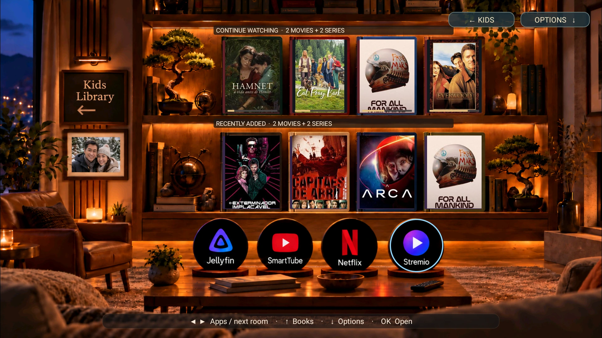
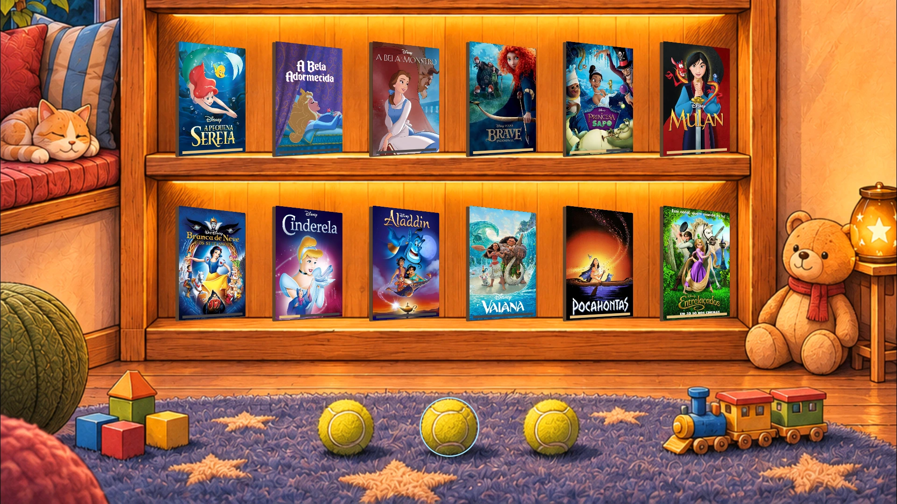
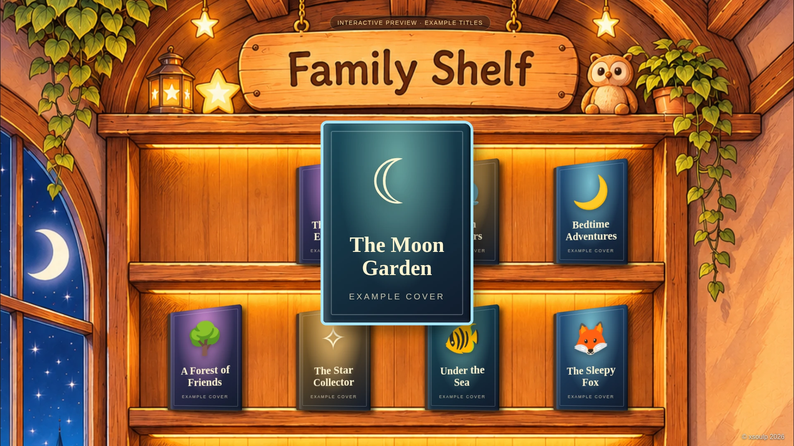
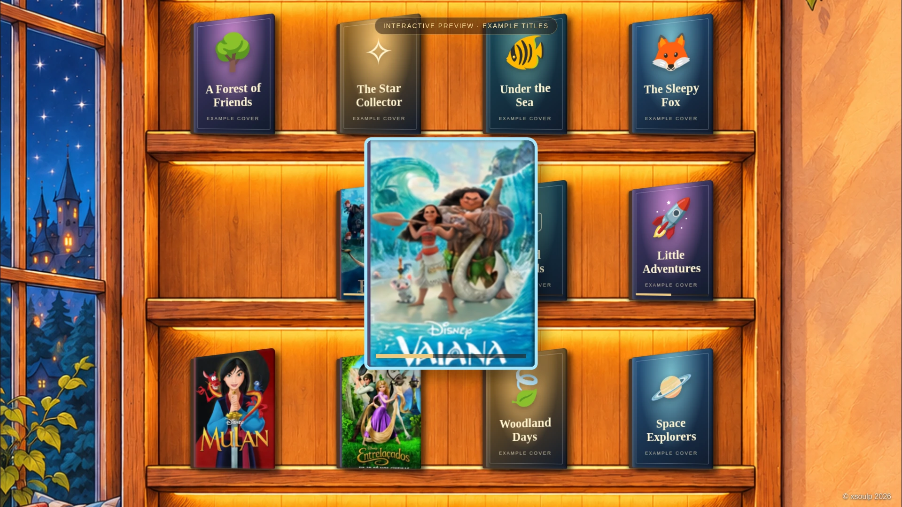
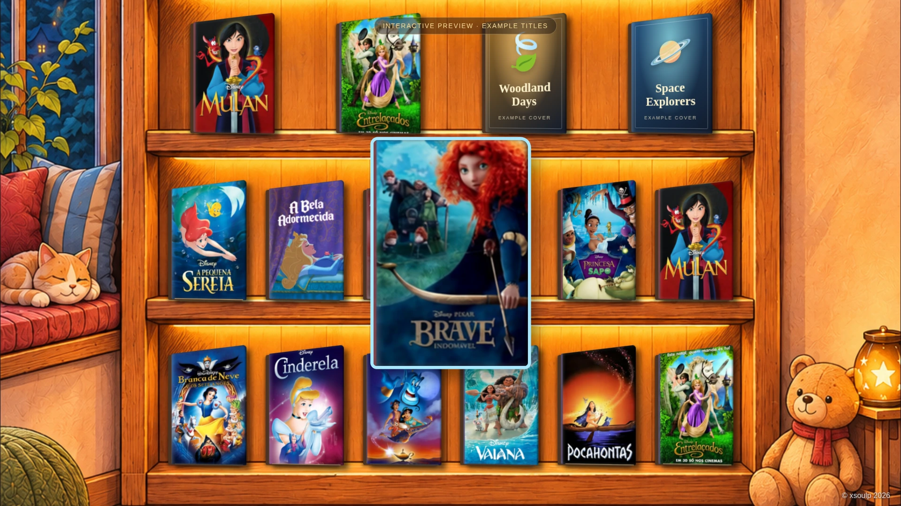

# Family Shelf

A cozy Android TV launcher for **Jellyfin and Netflix**, with illustrated Adults
and Kids rooms. Browse your media as books on a shelf using your TV remote.

## Features

- **Two rooms:** an Adults library and one continuous, six-shelf Kids bookcase for
  stories, films, series and Disney titles.
- **Animated covers:** books sit in perspective and slide forward when selected.
- **Your library:** Jellyfin continue-watching and recently added shelves, cached
  posters, and supported Netflix Watch Next titles.
- **App shortcuts:** open your media apps from the room. Three painted tennis
  balls on the Kids floor launch Jellyfin, Red Descent and Netflix.
- **Ambient sound:** separate Kids/Adults music, a mute switch and optional
  screensaver music.
- **Optional Lisbon screensaver:** day/night manga scenery, moving clouds, live
  weather, a tower clock and 1–12 church-bell strikes at the hour. Requires a
  location configuration when building.
- **Live aircraft:** real flight detections near Lisbon's Ponte 25 de Abril trigger
  manga planes with airline-coloured tails and a pass-by sound. Optional overlays
  also work with supported Netflix/Jellyfin playback and Android permissions;
  planes over video are half-size and silent.

| Adults room | Kids room |
| --- | --- |
| <a href="docs/examples/adult-room.webp"></a> | <a href="docs/examples/kids-manga-floor.webp"></a> |

### PC previews

| Kids: top shelves | Kids: middle shelves |
| --- | --- |
| <a href="docs/examples/kids-pc-top-shelves.webp"></a> | <a href="docs/examples/kids-pc-middle-shelves.webp"></a> |

Selecting a movie pulls its cover forward and turns it straight toward the viewer:

<a href="docs/examples/kids-pc-selected-movie.webp"></a>

| Screensaver by day · easyJet example | Screensaver by night · Ryanair example |
| --- | --- |
| <a href="docs/examples/screensaver-pc-day-aircraft.webp"></a> | <a href="docs/examples/screensaver-pc-night-aircraft.webp"></a> |

The room images above are TV captures. The **PC previews** are browser-rendered
examples with **© xsoulp 2026** visible; weather, clock and flights in the screensaver
previews are illustrative. They are not live flight detections or APK captures.
You can open the [room preview](docs/preview/index.html) or
[screensaver preview](docs/preview/screensaver.html) locally to explore the examples.

Media artwork is example library content, not supplied with the app. Public room
portraits are fictional; interface labels are English and covers keep their original
language. See the [detailed reference](docs/REFERENCE.md) for more examples and details.

## Install the APK

Requires **Android TV / Google TV with Android 6.0 or newer**. Install Jellyfin,
Netflix and any other media apps you want to launch separately. Family Shelf
browses your libraries; playback happens in those apps.

Download from the latest [**GitHub Release**](https://github.com/xsoulp/family-shelf/releases/latest):

1. Under **Assets**, download **family-shelf-home.apk** for the launcher, or
   **family-shelf.apk** for a regular TV app.
2. Optionally verify it against **SHA256SUMS**.

Release assets become publicly downloadable without signing in when this repository
is public. Private repositories require access. If the first release is still
building, wait for the [Public APK workflow](https://github.com/xsoulp/family-shelf/actions/workflows/public-apk.yml)
to finish, or [compile locally](#compile).

For development builds, use the [**Public APK** build page](https://github.com/xsoulp/family-shelf/actions/workflows/public-apk.yml):

1. Open the latest successful run (green check).
2. Under **Artifacts**, download **family-shelf-public-apks** and unzip it.
3. Choose **family-shelf-home.apk** for the launcher, or **family-shelf.apk** for a
   regular TV app. The download also includes SHA-256 checksums.

GitHub requires sign-in and repository access to download these workflow artifacts.
Tagged versions also publish APKs as GitHub Release assets.
Builds run automatically after a push to `main`; if none has finished yet, wait for
that run or [compile locally](#compile). Public APKs use example assets and contain
no personal photo, selected weather location or private soundtrack.


1. Copy the APK to your TV using a USB drive or your preferred file-transfer app.
2. Allow APK installation for the file manager you use, then open the APK to install.
3. Open **Family Shelf** from the TV's apps list. If using the Home-enabled APK,
   you can also select it as the default Home app in Android settings where supported.

With Android Platform Tools and network debugging enabled, you can install from
a computer instead:

```bash
adb connect YOUR_TV_IP:5555
adb -s YOUR_TV_IP:5555 install -r family-shelf-home.apk
adb -s YOUR_TV_IP:5555 shell am start -n com.xsoulp.livingroom/.MainActivity
```

Replace the APK filename with the one you downloaded. When updating, use the same
APK variant and signing key to retain app data. If Family Shelf is already your
Home app, update with the Home-enabled variant.

### First setup

1. Open **Options → Connect / change Jellyfin account** and enter your server URL.
   Approve Quick Connect from another signed-in Jellyfin client, or sign in on the TV.
2. Use **Options → Libraries for this view** in each room to choose your libraries.
   Family Shelf needs its own Jellyfin login, even if the Jellyfin TV app is signed in.
3. For Netflix shelves, use **Options → Netflix for this view**. Shared titles depend
   on Netflix and your TV's Watch Next support.

**Left/Right** selects a book or app; crossing an edge switches rooms.
**Up/Down** moves between shelves, **OK** opens an item and **Back** moves to the
floor apps. **Menu** or a long press on **OK** opens Options. Rooms organize the
launcher; the media apps keep their own accounts and profile controls.

## Compile

Install **JDK 17+**, the Android SDK, **Platform 36** and **Build Tools 36.0.0**.
The Gradle wrapper downloads the project's Gradle version and dependencies.

```bash
git clone https://github.com/xsoulp/family-shelf.git
cd family-shelf
export ANDROID_HOME="$HOME/Android/Sdk"  # Adjust to your SDK location.
sdkmanager "platforms;android-36" "build-tools;36.0.0"
bash build.sh -PhomeEnabled=true -PpublicDebugSigning=true
```

The Home-enabled APK is saved to `artifacts/living-room-tv-home-debug.apk`.
To build a regular app without the Home role, use
`bash build.sh -PpublicDebugSigning=true`; its APK is
`artifacts/living-room-tv-debug.apk`. Both commands also run Android lint.
These are debug-signed APKs for sideloading. The public signing option uses the
same development key as the downloadable artifacts; omit it to use your own local
key. See [public build notes](.github/PUBLIC_APK.md).

To build and then install on a connected TV:

```bash
bash install.sh YOUR_TV_IP:5555
```

The installer uses the last build at `app/build/outputs/apk/debug/app-debug.apk`.
To run the local regression tests:

```bash
./gradlew testDebugUnitTest
```

## Personalize

### In the app

Use Options to choose room libraries, associate Netflix titles, switch music on
or off, and enable the screensaver, hourly bells or video-aircraft overlays.
For aircraft over video, **Options → Video aircraft overlay** links to Android's
**Display over other apps** and **Notification access** settings. Notification
contents and screen contents are not read. Optional remote-button mappings can be
enabled in Android accessibility settings.

### Your own photo, weather location and music

These settings are packaged **when compiling**. Create an ignored
`.private/room-assets/` directory and add any of these optional files:

| File | Purpose |
| --- | --- |
| `adult-room-photo.jpg` | Your photo inside the Adults room's frame |
| `outdoor-scene.json` | Enables the screensaver and sets weather coordinates, label and time zone |
| `outdoor-ambient.mp3` | Your quiet looping screensaver soundtrack |

Example `outdoor-scene.json`:

```json
{
  "label": "Lisbon · Castle view",
  "timezone": "Europe/Lisbon",
  "latitude": 38.72509,
  "longitude": -9.1498
}
```

Then rebuild with `bash build.sh -PhomeEnabled=true -PpublicDebugSigning=true`. An external private directory
can be supplied with `-PprivateAssetsDir=/path/to/your/assets`.

The bundled scenery and aircraft detection area depict Lisbon. Changing weather
coordinates does not redraw the landscape or move the bridge detection area.
Only use music and images you have permission to include, and keep personal APKs,
photos, credentials and local settings out of public uploads.

### Change the artwork or shortcuts

Room backgrounds and sprites are in `app/src/main/assets/`. The Kids background is
one tall image with six shelves and three painted balls. Keep their positions or
update `KidsBookcase.java` and the app-target positions in `MainActivity.java` to
match. App package names and shortcut choices are defined in `MainActivity.java`.
See the [Kids artwork prompt and coordinates](docs/kids-manga-room-provenance.json)
and [detailed reference](docs/REFERENCE.md) before changing the layout.

## License and acknowledgments

Original project code and documentation are released under [MIT-0](LICENSE).
You may use, modify and redistribute them, including commercially, without an
attribution requirement.

If you reuse Family Shelf or build something inspired by its room-and-shelf idea,
please acknowledge **Family Shelf by xsoulp (2026)** and link to
[this repository](https://github.com/xsoulp/family-shelf) in your README or credits.
This is a friendly request, not a license condition.

Third-party music, tools, media artwork, logos and data retain their own rights
and licenses; see [third-party notices](THIRD_PARTY_NOTICES.md). The MIT-0 grant
covers only material the project author can license.

## More information

- [Detailed feature and setup reference](docs/REFERENCE.md)
- [Third-party artwork, audio and data credits](THIRD_PARTY_NOTICES.md)
- [Privacy notes](docs/PRIVACY.md)
- [Tests and known device limitations](VALIDATION.md)
- [Project history](HISTORY.md)

© xsoulp 2026
