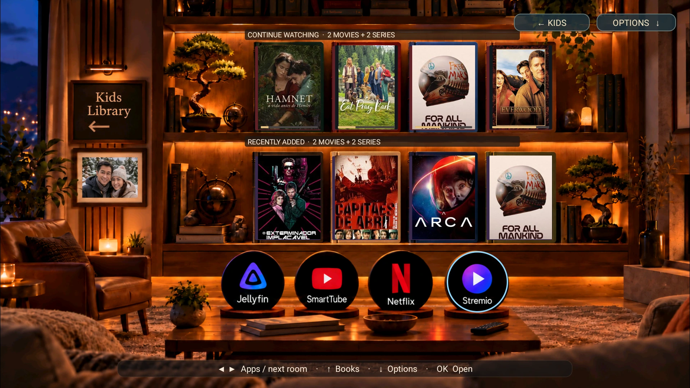
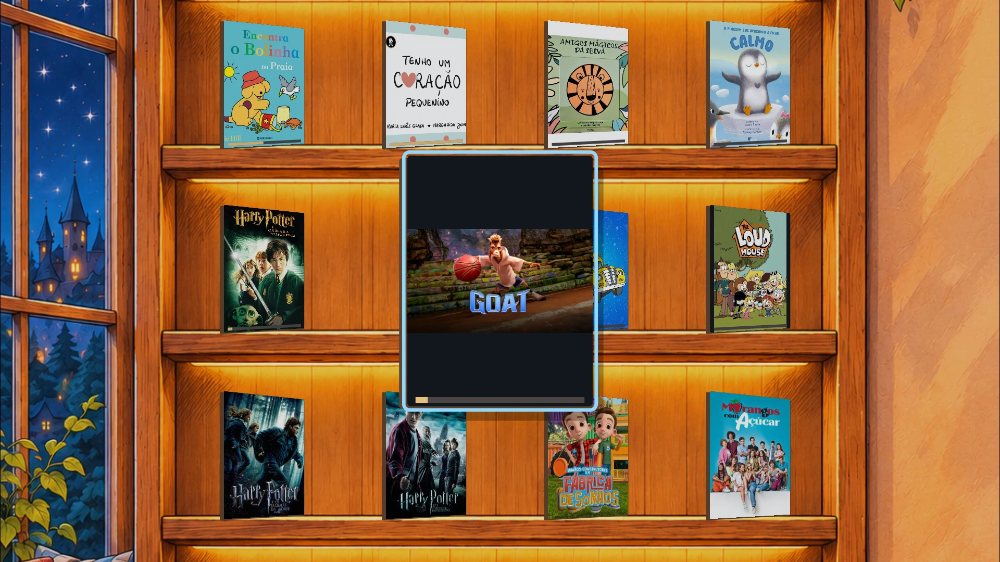
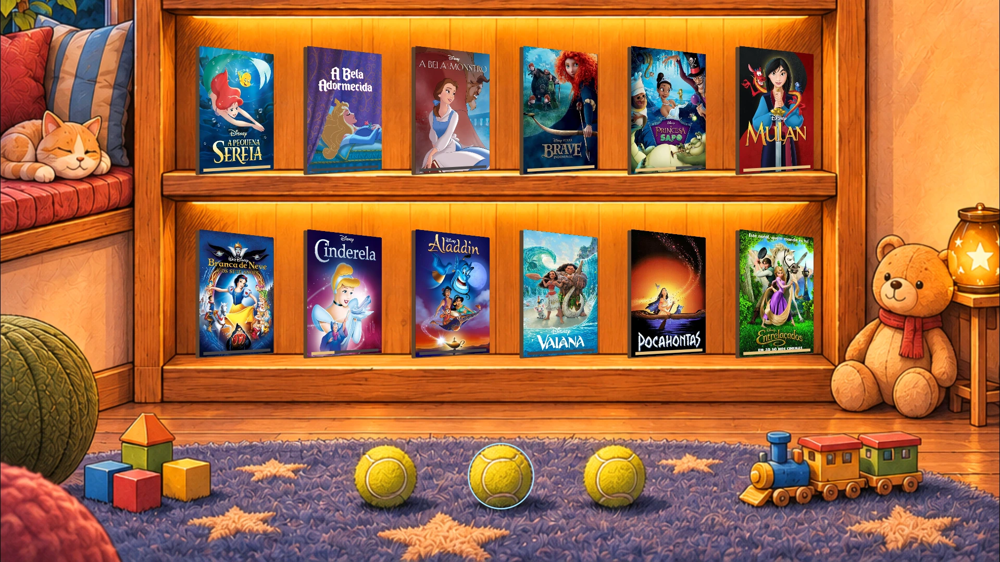

# Family Shelf — detailed reference

Advanced setup, feature behaviour and implementation notes. Start with the
[README](../README.md) for installation and everyday use.

A native Android TV launcher focused on showing **Jellyfin and Netflix content**
in visual shelves, with separate rooms for adults and children. Films, series,
books and app shortcuts share a warm, illustrated home.

Navigate with a TV remote, browse real Jellyfin library content, resume supported
Netflix titles and open your media apps from a warm, illustrated room.

**Current version:** 0.15.2 · **Repository name:** `family-shelf`

## Screenshots

The Adults room and Kids floor examples are native TV captures. The selected-cover
capture below shows the current manga bookcase. Public portraits are fictional;
account details and private photographs are excluded.

Media titles and artwork are example library content. Interface labels are English;
covers retain the language supplied by the library.

### Adults room



### Kids room

Up/Down moves through one bookcase; selecting a cover pulls it forward. App
shortcuts sit on the floor below.





The [README gallery](../README.md#pc-previews) also shows browser-rendered top and
middle shelves, plus a movie selection. Older design captures have been removed.

### Screensaver views

These browser-rendered examples show the day/night scene, clouds, clock and manga
planes. Weather, time and flight details are illustrative, not live detections.

| Day · easyJet example | Night · Ryanair example |
| --- | --- |
|  |  |

The [room generation prompt and registration](kids-manga-room-provenance.json)
record how the manga artwork aligns with the six shelves and three app targets.

The Kids bookcase can also be tried locally after cloning: open
[the interactive design preview](preview/index.html), use the arrow keys,
then click **Music off** to audition the soundtrack. **Adults** switches its scene
and track. This browser preview uses example content; it is separate from the
native Android app and does not deploy anything to the TV.

## Rooms

Kids content now lives in **one continuous bookcase**. Up/Down pans the camera
between six vertically stacked shelves; Left/Right selects a cover. Moving beyond
either end of any shelf changes between Kids and Adults, entering at the opposite
edge of the corresponding upper/lower row. Returning to Kids restores the same
section of the bookcase. The nearest horizontal position is preserved when moving
vertically between four- and six-cover rows.
Covers now sit in perspective like books on the shelves. Moving focus pulls the
selected cover forward over 420 ms, enlarges it and turns it straight toward the
viewer at a modest 420-unit height so neighbouring books remain visible; the previous cover slides back. The foreground cover remains selectable
with OK or touch. This applies in both rooms without changing shelf positions or
navigation.

The interface and documentation use English.

| Kids shelf | Content | Covers |
| --- | --- | --- |
| 1–2: Books & Stories | Eight Jellyfin books | Four per row |
| 3: Continue watching | Kids films and series, including confirmed Netflix titles | Four |
| 4: Recently added | Kids films and series from Jellyfin | Four |
| 5–6: Disney | Twelve Disney films from Kids Jellyfin libraries | Six per row |

The existing Adults room keeps its two media shelves and Jellyfin, SmartTube,
Netflix and Stremio shortcuts. Use the on-screen **Adults / Kids** control or
**Options → Go to Adults/Kids library** to change rooms. **Back**, or **Down** after
the sixth Kids shelf, moves the camera down to Jellyfin, Red Descent and Netflix
app toys resting on the rug. Kids now has no overlaid room/section labels, shelf counter, navigation hints or
text buttons. Three tennis balls, their contact shadows, blocks and a wooden train are painted
into the manga room background. Invisible app targets align with the balls; only
the focus outline is drawn on top. The balls have no names or icons; selection
outlines remain. App names are retained in accessibility descriptions. Use Menu
or long-press OK for settings. Cover artwork and the decorative Family Shelf sign
retain their original text. **OK** opens the app, **Up** returns to the saved shelf, and
crossing either end of an app row also changes rooms.
Existing room preferences migrate to the matching position in the combined Kids
bookcase; library selections and account data remain in place.

Video rooms combine ongoing films and series with recent Jellyfin additions.
Selected Netflix titles can occupy the ongoing positions, with saved records or
Jellyfin titles from the same view as fallbacks. Empty or unavailable sources show
an explanation or shortcut. Viewing progress is never invented. Recently added movies exclude ongoing Jellyfin
movies and the confirmed Netflix movie currently shown in the same view. The
next eligible additions fill the two movie positions; if none remain, the shelf
shows an explicit empty position.

At startup, saved shelves and Jellyfin covers can appear from the app's private
cache while live data refreshes. Temporary network/server failures retry automatically
with a delay increasing from 2 seconds to at most 60 seconds. Failed cover downloads
retry independently, so opening the Jellyfin app is unnecessary. Leaving the launcher
cancels scheduled retries; returning or waking the screen refreshes again. Cache
entries are separated by account, room, library choices and Netflix selections;
signing out clears the startup cache. Saved progress may be older until refresh succeeds.

The repository is hosted at [github.com/xsoulp/family-shelf](https://github.com/xsoulp/family-shelf).

To use a personal photo in the Adults room, place a JPEG named
`adult-room-photo.jpg` in the ignored `.private/room-assets/` directory before
building. The image fills the existing frame without changing the public room
artwork. An external private asset directory can also be supplied with
`-PprivateAssetsDir=/path/to/private/assets`. Personal assets and APKs must stay out of version control and public uploads;
builds without the optional photo retain the
fictional example portrait.

## Outdoor screensaver

With a private weather location configured, two minutes without remote input opens
a manga-style Lisbon castle view. Matching day/night artwork follows local sunrise
and sunset. Generated transparent cloud textures have softly lit, detailed manga volume;
clouds move with modelled cloud cover and wind, with rain/snow/fog when
reported. A clock drawn on the bell tower shows the real local time, including a
moving second hand. Temperature, conditions, source/update time and the date remain
visible. The room music switches to the optional private outdoor track while the scene is visible.

The TV build can loop a user-supplied `outdoor-ambient.mp3` from the private assets
directory. It plays at a quiet 7% gain with a short fade-in; the file is unchanged
and never bundled in public builds. The supplied Bonito, Bonito recording is used
only in the owner's private installation. Opening another app or sleeping the
screen stops playback, and audio focus is respected.

Each visible aircraft gets one soft downloaded aircraft pass-by as it approaches the centre
of the sky. It is triggered by the animation, rather than by repeated API responses.
The CC0 “Airplane, pass #4” sound by Dj Lio/BigSoundBank plays once at 16% gain.
Its full duration is retained, converted to mono 22,050 Hz PCM16 for SoundPool. Hiding the scene, muting background
music or losing audio focus stops both music and effects. The existing Background
music switch also mutes the outdoor audio.

The first remote press or touch closes the scene and is consumed so it cannot
accidentally open a title. The outdoor landscape never covers other apps or sleeping screens.
**Options → Outdoor screensaver** can disable automatic entry or preview current,
daytime and night-time scenes. Previews are explicitly labelled.

The location is read from an ignored `.private/room-assets/outdoor-scene.json` file
(or the private assets directory supplied at build time):

```json
{"label":"Lisbon · Castle view","timezone":"Europe/Lisbon","latitude":38.72509,"longitude":-9.1498}
```

Weather uses [Open-Meteo](https://open-meteo.com/en/docs). It refreshes at most every
15 minutes while the scene is visible; transient failures retry after one minute.
Saved readings are labelled after 45 minutes. With no usable solar data, day/night
uses a local-time approximation, while unavailable weather is clearly identified.
The public build has no selected household location and does not start automatically
until this configuration is supplied.

A small plane crosses the sky only when fresh [ADSB.lol](https://api.adsb.lol/docs)
positions indicate an airborne aircraft entering/crossing the approximate bridge
corridor around Ponte 25 de Abril. It polls the free community API every 15 seconds
while visible, filters stale/ground records, checks crossings between consecutive
positions and suppresses repeat reports. Distinct later passes can trigger again.
Missing coverage, delays or service limits can miss a pass; the app never substitutes
random aircraft. Errors back off, and provider Retry-After delays are respected.
Provider and ODbL credits appear on screen; details are in
[THIRD_PARTY_NOTICES.md](../THIRD_PARTY_NOTICES.md).

Landscape artwork was created with the built-in image generation tool. The
[day/night prompts and drawing coordinates](screensaver-image-prompts.json)
are saved for reproducibility. The animated cloud sprite uses the built-in image
generation tool; its [full prompt](screensaver-cloud-prompt.txt) is also saved. These are artistic views, not literal photographs.

The [day/night gallery](#screensaver-views) above uses explicitly labelled browser
examples. Native aircraft appearances still require real detections.

## Hourly church bell

Only while the outdoor screensaver is visible and audible, a quiet church
bell strikes at the exact local hour: 1–12 times, with twelve at midnight/noon.
It uses the screensaver's configured time zone, or the device time zone without
private scene settings. Strikes are spaced 2.4 seconds apart with natural decays.
**Options → Hourly church bell** provides an on/off switch and **Preview one bell**, which opens the screensaver.

The existing Background music mute and audio-focus policy also gate the bell.
Leaving the screensaver, sleeping the screen, muting or losing focus stops the
sequence. Missed hours are not replayed on wake, launch or clock changes, and a
saved hour marker prevents duplicate sequences after Activity recreation.
No alarm or wake lock is added, and bells do not play over Netflix/Jellyfin video.

The downloaded [Bell 1 O'clock](https://bigsoundbank.com/bell-1-o-clock-s3446.html)
by Joseph SARDIN & Axeline T. is CC0. Its complete real recording is converted to
mono 22,050 Hz PCM16 for playback; no new audio was generated. Source and hashes
are in [church-bell-source.json](church-bell-source.json).

## Aircraft over Netflix and Jellyfin

**Options → Video aircraft overlay** enables the same live bridge-crossing
logic while Netflix or Jellyfin reports that a video is playing. Android must grant **Display
over other apps** and **Notification access**; the latter allows playback-state
observation through MediaSession. Family Shelf ignores notification contents and
reads no screen contents. The existing remote-button accessibility service can
observe foreground app names to stop the overlay when another app opens.

The transparent aircraft window appears only for detected passes, near the top of
the screen, and accepts neither focus nor remote/touch input. Pausing playback,
returning to the launcher, sleeping the screen or disabling the feature removes
it. Each plane has one quiet aircraft pass-by sound at 12% gain, without requesting audio focus or
controlling video playback. The Background music switch also mutes this effect.
The private outdoor song plays only in the screensaver. Android or the video app
may restrict overlays; real playback compatibility must be checked on the device.

Supported Jellyfin players are the Android TV app, the mobile app and Findroid,
matching the launcher's existing shortcuts. A playing session must belong to the
foreground app when its package is known, so a stale Netflix session cannot enable
aircraft over an idle Jellyfin screen, or vice versa. Existing overlay preferences
and Android permissions survive updates. Some Jellyfin clients leave Android's
playback state at NONE even while video is playing. For those sessions, a read-only
server check runs about every three seconds, using the existing Jellyfin login.
It requires the same account, this box's network address, the matching client,
a video item, an explicit unpaused state and a playback check-in no older than
20 seconds. Failed/ambiguous checks stop authorizing the overlay; no additional
permission, player control or persistent viewing log is added. Pause detection in
this fallback follows server reports and polling rather than an instant callback.

The screensaver and both video apps share a detailed painted manga airliner, with
realistic fuselage lighting, cockpit/windows, swept wings and a turbofan engine. Callsign prefixes choose
illustrative operator colours: easyJet orange, Ryanair navy/yellow, Vueling
grey/yellow and TAP green/red. Unknown operators retain a neutral tail. These are
stylised colour cues rather than exact airframe liveries. The transparent sprite
is generated artwork; its [prompt and tail-colour registration](aircraft-realistic-manga-provenance.json)
are saved. Aircraft labels show only
the callsign and known airline above the plane, with no lower caption. Video-overlay
flight-data credits are available under **Options → Video aircraft overlay → About
video aircraft**; the screensaver retains its existing footer credits. Flight detection,
freshness checks and duplicate suppression remain unchanged.


## Build

Requirements: JDK 17 or newer, Android SDK Platform 36 and Build Tools 36.0.0.
The project uses the Gradle wrapper (9.6.0) and Android Gradle Plugin 9.4.0.
The first build needs internet access to download tools and dependencies.

Clone the repository and build from its root:

```bash
git clone https://github.com/xsoulp/family-shelf.git
cd family-shelf
sdkmanager "platforms;android-36" "build-tools;36.0.0"
bash build.sh
```

Set `ANDROID_HOME` if your SDK is outside `~/Android/Sdk`.
`local.properties` is generated locally and is ignored by Git.
The build compiles the app and runs Android Lint.

| Build | Command | Copied APK |
| --- | --- | --- |
| Ordinary TV app | `bash build.sh` | `artifacts/living-room-tv-debug.apk` |
| Home-enabled launcher | `bash build.sh -PhomeEnabled=true` | `artifacts/living-room-tv-home-debug.apk` |

Both variants also produce `app/build/outputs/apk/debug/app-debug.apk`, which is
used by the installer. These are debug-signed APKs for sideloading.
Android 6.0 (API 23) or newer is required. The launcher uses Java and Android Canvas
and does not require ARM64 native libraries.

## Install

Enable network debugging on the TV and authorize your computer, then run:

```bash
bash install.sh YOUR_TV_IP:5555
```

Pass the TV address explicitly, or set `ANDROID_TV_TARGET` in your environment.
It installs the most recently built debug APK with existing app data preserved
and opens the launcher.

The ordinary build appears in the TV's app list. To make Family Shelf a Home
candidate, build with `-PhomeEnabled=true` and select it in Android's Home settings
where supported. Installation alone does not select the default Home app.
If it is already your Home app, use the Home-enabled variant for updates; the
installer checks this before replacing it.

The development Xiaomi box has a specific Google TV recovery script:

```bash
bash restore-google-tv.sh YOUR_TV_IP:5555
```

This re-enables the stock Google TV packages and restores their Home role and
activity. Restore the stock launcher before installing a build with Home disabled.
The script targets that Xiaomi/Google TV setup; other devices may differ.

## Connect your libraries

Open **Options → Connect / change Jellyfin account** and enter your server URL.
Use Quick Connect and approve the code from a signed-in Jellyfin client, or use
the on-device login form. Family Shelf needs its own session even if the Jellyfin
TV app is already signed in.

In each video view, use **Options → Libraries for this view** to choose its libraries.
The launcher can initially recognise `Movies (kids)` / `Shows (kids)` and
`Movies (18+)` / `Shows (18+)`, plus supported equivalent names.
Books come from `Books & Stories` or `Books and Stories`. The legacy library name
`Livros e historias` is also recognised, including accents, so existing libraries
need no rename. Disney Library uses the children's movie libraries and a fixed
catalogue. Film matching retains Portuguese and original-title aliases, while
built-in catalogue labels use English.

Use **Options → Netflix for this view** to associate available Netflix titles with
the current view. Netflix Watch Next availability depends on the TV firmware and
what Netflix shares. Its records do not identify Netflix profiles, so associations
are confirmed by the user. Separating rooms organises the launcher; external apps
retain their own accounts and profile selection.

Jellyfin and other media apps must be installed separately. Opening a Jellyfin
title uses the installed client's supported entry point; playback happens there.
Red Descent uses package `pt.reddescent.game` and must also be installed separately.

## Remote controls

| Control | Action |
| --- | --- |
| Left / right | Select a cover or app; cross either end to switch Kids/Adults rooms |
| Up / down | Pan through Kids shelves; move between Adults shelf rows, apps and Options |
| OK / Enter | Open the selected item, app or Options |
| Long OK / Menu | Open Options |
| Back | Leave shelves or Options; stay in the launcher when it is Home |

On the configured Xiaomi remote, Netflix opens Netflix, Prime Video opens Jellyfin,
and YouTube opens SmartTube. For these keys to work across apps, enable
**Family Shelf remote buttons** through
**Options → Remote buttons: Netflix / Jellyfin / SmartTube** in Android accessibility
settings. The service filters these keys without reading screen contents.
These mappings use the tested Xiaomi key layout; other remotes may differ.

The current [Kids floor capture](examples/kids-manga-floor.webp) shows the painted
app balls and their selection targets.

## Ambient music

Kids uses **Music Box Theme**, shared by its books, media and Disney shelves.
Adults uses **Darkest Child**, a suspense track with celesta, harp and low strings.
Both are downloaded recordings by Kevin MacLeod, play softly, and fade in when the launcher
has audio focus. Music stops when another app opens or the screen turns off.
**Options → Background music** saves an on/off preference. It leaves another
music app's existing playback alone. See [music notes](AMBIENT_MUSIC.md) for
the track sources, attribution and playback behaviour.

## Project naming

**Family Shelf** is the project name; use **`family-shelf`** for the repository.
The Android app appears as **Family Shelf**, and the accessibility service
as **Family Shelf remote buttons**. The package/application ID remains
`com.xsoulp.livingroom`, the Gradle project name is `LivingRoomTV`, and build artifacts
retain their `living-room-tv` filenames. These existing identifiers are documented
so installation commands and updates continue to match the current app.

The English update retains existing application IDs and saved-data keys.
Historical records may also refer to Living Room TV or the local `myandroidtv` folder.

## Public source and privacy

This repository contains a public copy of the project. Personal photographs,
profile names, local server addresses, device exports, APKs and local credentials
are excluded or replaced with neutral examples. Public room backgrounds have
AI-generated portraits of fictional people in place of personal portraits.
Personal source photographs and unreviewed device captures are not part of this
repository. See [the privacy review](PRIVACY.md) for the publication scope.

## Development and validation

Main code is in `app/src/main/java/com/xsoulp/livingroom/`, room artwork and its
provenance are in `app/src/main/assets/`, and device tests are in
`app/src/androidTest/java/com/xsoulp/livingroom/`.

```bash
./gradlew assembleDebug assembleDebugAndroidTest lintDebug -PhomeEnabled=true
```

Use the Home flag for the configured development box; omit it for an ordinary app
on a stock device. The custom instrumentation runner can check room navigation
and shortcuts on a connected TV:

```bash
adb -s YOUR_TV_IP:5555 install -r app/build/outputs/apk/debug/app-debug.apk
adb -s YOUR_TV_IP:5555 install -r app/build/outputs/apk/androidTest/debug/app-debug-androidTest.apk
adb -s YOUR_TV_IP:5555 shell am instrument -w -e mode kids-game com.xsoulp.livingroom.test/com.xsoulp.livingroom.RoomSmokeInstrumentation
```

These tests control the TV interface. Connected-library checks require a paired
Jellyfin account. Results and known limitations are recorded in
[VALIDATION.md](../VALIDATION.md); building successfully does not establish that every
device check passed. Lint reports are written to `app/build/reports/`.

Jellyfin requests use a token in the standard `Authorization: MediaBrowser` header
and current `UserViews` / `UserItems/Resume` routes. Older user-specific routes
are tried only when a current route returns HTTP 404. HTTP 401 and 403 responses
retain their meaning: reconnect an expired session or check library permissions.

Local API/selection regression tests run without a TV or real account:

```bash
./gradlew testDebugUnitTest
```

Jellyfin passwords are not saved. Session tokens are encrypted using Android
Keystore, and app backup is disabled. Netflix history access uses the TV's shared
Watch Next provider and remains subject to its permission and visibility rules.

See [HISTORY.md](../HISTORY.md) for earlier versions, design changes, integration
references and historical device-specific notes.
